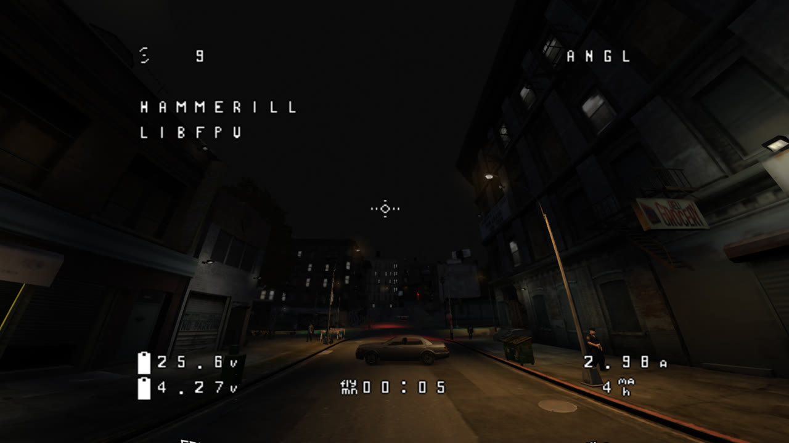

# GTA V Enhanced FPV



Fly an FPV drone through Los Santos with your own radio. Press F9 and a quad
launches from the street in front of you. The drone runs on
[libfpv](https://github.com/hammerill/libfpv), which embeds real Betaflight
firmware. Rates, angle mode, air mode, arming and turtle mode work as they do
on a real quad.

This mod is a port of [gtaiv-fpv](https://github.com/hammerill/gtaiv-fpv) by
hammerill from GTA IV to GTA V Enhanced. It uses a fork of libfpv,
[bwcon/libfpv](https://github.com/bwcon/libfpv), which adds Betaflight
2026.6, the HD OSD canvas and goggle fonts. It is an early release. See
[ROADMAP.md](ROADMAP.md) for the plan and the open items.

## Features

- Real Betaflight in the loop, with your rates, modes and tuning. Set up your
  radio once in the setup wizard. Betaflight Configurator can connect too.
- Drone models at real scale: a 5" freestyle quad whose props spin with the
  motors (a destroyed prop disappears), and a DJI Avata 2 for 3" quads and
  whoops. The quad preset picks the model, also when you change it in flight.
- Three cameras: FPV (the goggles view), chase, and line of sight from where
  the player stands. The chase camera's distance, height and follow speed are
  on the Camera page in the GTAVE.FPV tab.
- Betaflight OSD in two styles: the analog 30x16 canvas, or the DJI-style HD
  53x20 canvas. A goggles HUD shows signal bars, the flight timer and a
  recording dot. It adds bitrate and latency in the HD style, and the video
  channel in the analog style.
- Goggle fonts: copy the font folders from your goggles' SD card (DJI O3 PNG
  sheets or WTFOS `.bin` fonts) and pick one in the OSD settings.
- Goggles view: a fisheye lens, a goggles bezel around the picture, and a
  video look for each style. Analog has noise, tearing and breakup. Digital
  has block artifacts and freezes. The lens shader works only in the FPV view.
- Radio signal: the OSD RSSI and RSSI dBm drop with the distance to where you
  pressed F9, and behind buildings.
- GPS home is where the drone arms, as on a real quad. Betaflight's home arrow
  and home distance OSD elements point back to it.
- Collision with the world: buildings, the road, cars, peds and props, through
  the game's shape test probes.
- Motor sound from the libfpv synthesizer.
- The in-game radio plays while you fly. Change the station with `,` and `.`.
- FPV DVR: NVIDIA ShadowPlay records while the drone is armed, and stops 2
  seconds after you disarm.
- Move the player here: ends the flight with the player standing where the
  drone is.
- The player wears FPV goggles and holds a RadioMaster TX12 while flying. Any
  hat or glasses come off and go back on after. The GTAVE.FPV tab can turn
  each one off, adjust its fit, and pick how the radio is held.
- A stick overlay in the goggles view (mode 2), as in FPV videos. Turn it on
  in the GTAVE.FPV tab.
- Checkpoint races: record gates in flight with a radio switch, then fly
  timed laps through them.

## Controls

| Key | Action |
|---|---|
| F9 | Launch the drone, or return to the player |
| C | Cycle cameras: FPV, chase, line of sight |
| R | Respawn the drone at its launch point, repaired |
| Y | Move the player to the drone |
| O | Switch the OSD style: analog or HD |
| G | Show or hide the goggles bezel |
| P | New propellers, where the drone is |
| `,` and `.` | Previous or next radio station |
| N | Start recording a race, or save the recorded race |
| M | Mark a gate while recording (the AUX3 switch does the same) |
| U | Remove the last gate while recording |
| E | Mark the finish gate and save a point to point race |
| L | Load the next saved race, or turn races off |

All libfpv settings (radio setup, rates, OSD layout, fonts, camera and quad)
are in ReShade. Press Home and open the GTAVE.FPV tab. Like other add-on tabs,
you can undock it and drag it to another place.

The goggles view has its own settings in ReShade's Home page. Select the
"GTAVE.FPV lens" effect, and the settings show below the effect list:

- Goggles: the goggles frame on or off (G does the same in the game).
- Goggles size: 1 fills the window. A smaller value shows black around the
  goggles, and a larger value enlarges the picture.
- Camera FOV (vertical): the same setting as the Camera page in the GTAVE.FPV
  settings.
- Video signal: Auto (analog with the analog OSD, digital with the HD OSD),
  Analog, Digital, or Clean (no interference).

Without a radio, the keyboard works as a fallback. Enter arms, W and S are
throttle, A and D are yaw, and the arrow keys are pitch and roll. A gamepad
works too.

## Requirements

- GTA V Enhanced (the 2025 PC edition), story mode only.
- [ScriptHookV](http://www.dev-c.com/gtav/scripthookv/) with GTA V Enhanced
  support, and its ASI loader (`dinput8.dll`).
- [ReShade](https://reshade.me) 6.x with full add-on support (the "with full
  add-on support" installer), installed for GTA V Enhanced with DirectX 12.
- Windows 10 or 11.
- Optional: an FPV radio in USB joystick mode, and the NVIDIA app for the DVR.

Turn off DLSS frame generation for FPV flying. Frame generation adds input
latency, and no script function can switch it off.

The mod was tested together with the RenoDX DLSS 5 mods and the NVE
(NaturalVision Enhanced) mod. Keep the "GTAVE.FPV lens" effect last in
ReShade's effect list, after the NVE effects.

## Installing

Copy these files into the game folder, next to `GTA5_Enhanced.exe`:

| File | Where it goes |
|---|---|
| `GTAVE.FPV.asi` | The game folder. The ASI loader loads it. |
| `GTAVE.FPV.core.dll` | The game folder. This is the mod itself. |
| `libfpv.dll` | The game folder. This is the drone simulator. |
| `GTAVE_FPV_Lens.fx` | `reshade-shaders\Shaders` |
| `GTAVE_FPV_Bezel.png` | `reshade-shaders\Textures` |
| `dlcpacks\gtavefpv\dlc.rpf` | The drones (a 5" freestyle quad and a DJI Avata 2), the pilot's goggles and radio. See below. |

The drone model is an add-on dlcpack. With onigiri, copy the `gtavefpv`
folder to `onigiri\dlcpacks`, and add this line before `</Paths>` in
`onigiri\common\data\dlclist.xml`:

```
<Item>dlcpacks:/gtavefpv/</Item>
```

Without the pack, the mod uses a small game prop as the drone.

Then do these steps:

1. Start the game and load story mode.
2. Press Home to open ReShade, and turn on the "GTAVE.FPV lens" effect. Keep
   it on: the mod shows the lens only in the FPV view.
3. Press F9 to launch the drone.
4. Open the GTAVE.FPV tab in ReShade and follow the radio setup wizard once.

If you turn the effect off and ReShade has "Load only enabled effects" set,
ReShade skips the effect on the next start, and the mod cannot turn it on.
Turn it on again in the Home page.

### Goggle fonts

1. Make the folder `%APPDATA%\libfpv\fonts`.
2. Copy each font package into it as its own folder, with the files unchanged.
   For example, `fonts\SNEAKY_FPV_O3_CLASH_BTFL\BTFL_CLASH_O3.png`.
3. In the GTAVE.FPV tab, open the OSD page and pick the font in the Font list.

The mod uses these files:

- DJI O3 fonts: `*_O3.png` or `*_HD.png` for the HD style, and `*_SD.png` for
  the analog style. Use the Betaflight (BTFL) variants.
- WTFOS (msp-osd) fonts: `font_bf_hd.bin` for the HD style, and `font_bf.bin`
  for the analog style.

### Files the mod writes

- `%APPDATA%\libfpv`: libfpv settings, radio mappings and Betaflight
  settings. The standalone libfpv app and other libfpv games share this
  folder.
- `GTAVE.FPV.ini` in the game folder: the drone model, the bezel opening and
  the DVR mode. A crash bends the propellers. By default the mod fits new
  ones when you disarm, and keeps the battery as it is.

The GTAVE.FPV tab has three flight options:

- Full realism: bent props stay bent until P or R (`[Drone] NewPropsOnDisarm=0`).
- Repair on arm: every arm gives new props, cool motors and a full battery
  (`[Drone] RepairOnArm=1`).
- New GPS home point at every arm: on by default. Turn it off to keep the
  first arm's home for the whole flight. This is Betaflight's
  `gps_set_home_point_once` setting. Set `[DVR] Mode=off` to turn off the ShadowPlay recording.
- `GTAVE.FPV.log` in the game folder: the mod log.

## Checkpoint races

A race is a loop of gates (a circuit) or a line of gates from a start to a
finish (point to point). The first gate is the start.

1. Fly to where the start line should be, and press N to start recording.
2. Fly the course. At each gate position, flick the AUX3 switch (the beeper
   switch) or press M. The gate faces the way the drone flies at that moment.
3. If a gate is in the wrong place, press U to remove it.
4. Save the race. The race needs two gates or more.
   - For a circuit, press N. The start gate is also the finish line.
   - For a point to point race, fly to the finish and press E. E marks the
     finish gate there and saves the race.
5. Fly through the green gate to start the clock. The next gate is yellow,
   and a point to point finish gate is white.
   - On a circuit, each lap ends at the start gate. The HUD shows the lap,
     the last lap time and the best lap time. The race ends after the number
     of laps in the GTAVE.FPV tab (0 is endless practice).
   - Point to point, the clock stops at the finish gate. Fly back to the
     green gate to go again.

Races are saved as text files in the `fpv-data\races` folder in the game
folder, one gate per line. You can share them or edit them by hand. Press L to load the
next saved race, and press R to restart the lap from the start gate.

Race settings in `GTAVE.FPV.ini`, section `[Race]`:

- `MarkSwitch`: the AUX number of the gate mark switch (default 3).
- `GateRadius`: the gate radius in metres (default 2.0).
- `Laps`: the laps in a circuit race (default 3, 0 is endless). The
  GTAVE.FPV tab also sets it.
- `MarkerYaw`: degrees added to the drawn rings' rotation, if the rings do
  not face along the course.

## Tune it in Betaflight Configurator

The drone runs real Betaflight. You can set PIDs, filters, rates, modes and
the OSD layout in [Betaflight Configurator](https://app.betaflight.com).

1. In the game, launch the drone with F9.
2. In Configurator, open Options and turn on manual connection mode.
3. Select Manual Selection, enter `ws://localhost:5761` as the port, and
   connect.

For the HD OSD layout, set the video format to HD in the OSD tab. You can
place elements across all 53 columns.

## FPV DVR

If `[DVR] Mode=shadowplay` (the default), the mod presses Alt+F9 when you arm
and again 2 seconds after you disarm. Alt+F9 starts and stops a manual
recording in the NVIDIA app. Make sure that the NVIDIA app overlay is on and
that Alt+F9 is its record shortcut. The clips go to the NVIDIA app's video
folder. GTA's own Rockstar Editor cannot record the mod's camera.

## Building

The build uses an MSYS2 MINGW64 shell (x86_64 MinGW-w64 GCC, CMake and
Ninja).

```sh
# libfpv (from the bwcon/libfpv checkout next to this one)
cmake -S . -B build/win -G Ninja -DCMAKE_BUILD_TYPE=Release -DCMAKE_C_FLAGS=-fpermissive
cmake --build build/win

# this mod
cmake -S . -B build -G Ninja -DCMAKE_BUILD_TYPE=Release -DGTAVE_DIR="C:/path/to/GTA V Enhanced"
cmake --build build
cmake --build build --target deploy
```

The `deploy` target copies the mod, `libfpv.dll`, the shader and the bezel
into the game folder. If the game is running, the core DLL reloads within
about a second. The `.asi` and `libfpv.dll` stay locked until the game exits.

## How it works

- ScriptHookV from MinGW: the mod finds the ScriptHookV exports by their
  mangled names. Natives are called by hash on the script thread.
- Loader and core: the `.asi` owns the script, the log and the ReShade
  add-on registration. It forwards every tick and frame to the core DLL. When
  the core file changes, the loader swaps in the new core.
- Camera: a scripted camera follows the libfpv camera. The focus position
  follows the drone, so the map and collision stream around it.
- World collision: the libfpv raycast callback goes to synchronous shape test
  probes. A hit is mapped back to its ped, vehicle or object.
- Drawing: the OSD and the libfpv overlay are ImGui draw lists in the ReShade
  overlay. The lens, bezel and video look are one ReShade effect,
  `GTAVE_FPV_Lens.fx`. The mod sets its values every frame.

`MODLOG.md` is the development journal. It records addresses, decisions and
what was tested in the game.

## Credits

- [hammerill](https://github.com/hammerill): libfpv and gtaiv-fpv, which this
  mod is built on.
- [Betaflight](https://github.com/betaflight/betaflight) and SimITL: the
  flight controller firmware and its simulator target.
- Alexander Blade: ScriptHookV. crosire: ReShade.
- [stb_image](https://github.com/nothings/stb) by Sean Barrett: the PNG font
  loader.
- The 5" quad ("Neon Falcon") and its propeller: made by bwcon with
  [Meshy AI](https://www.meshy.ai).
- The 3" and whoop model: ["DJI Avata2"](https://sketchfab.com/3d-models/dji-avata2-e27ed758e2174a89a48368e84027f8d9)
  by raphael.harris.gaffga, [CC BY 4.0](https://creativecommons.org/licenses/by/4.0/).
  It was reduced, re-oriented and converted for GTA V with
  [Sollumz](https://github.com/Sollumz/Sollumz) (`tools/models`). DJI and Avata
  are trademarks of DJI. This mod is not affiliated with DJI.
- The pilot's goggles: ["Tripo FPV DJI Goggles"](https://sketchfab.com/3d-models/tripo-fpv-dji-goggles-9edb8544e5ba4cd1985fd997d366b260)
  by line-o, [CC BY 4.0](https://creativecommons.org/licenses/by/4.0/), reduced,
  scaled and converted the same way.
- The pilot's radio: ["Radiomaster TX12 rc radio controller"](https://sketchfab.com/3d-models/radiomaster-tx12-rc-radio-controller-0edc6bca739d4aa6952bb6b8747318bb)
  by flightclubua, [CC BY 4.0](https://creativecommons.org/licenses/by/4.0/),
  reduced, scaled and converted the same way.
- Written with Claude (Anthropic).

## License

GPL-3.0-or-later, the same as libfpv (which embeds Betaflight). See
[LICENSE](LICENSE) for the full text.
